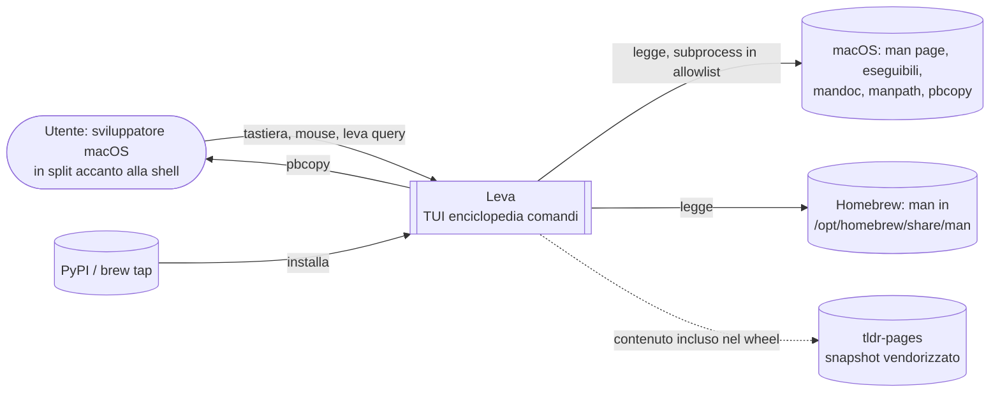
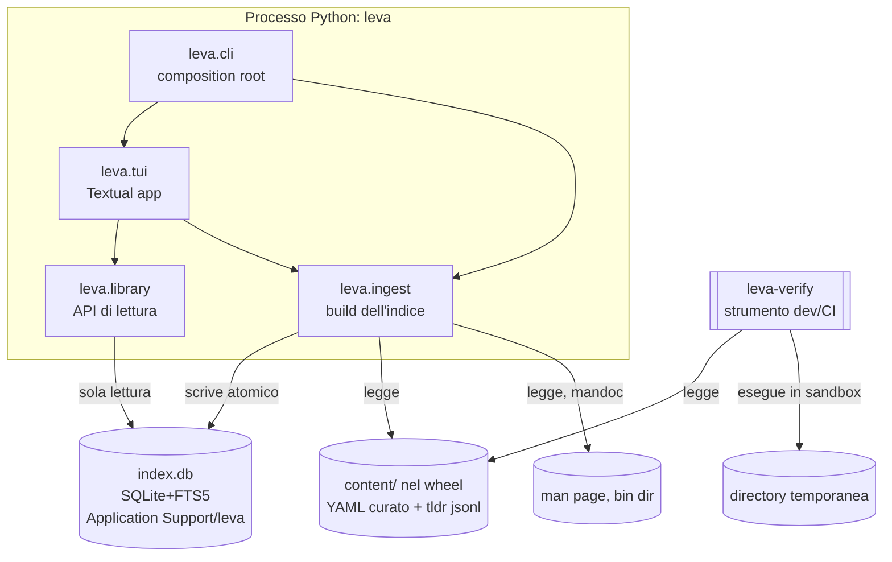
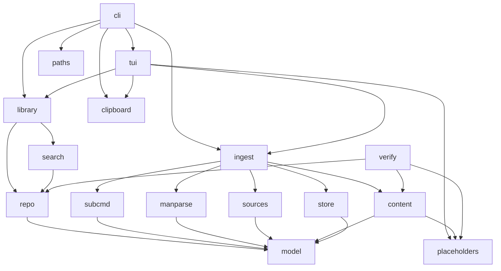
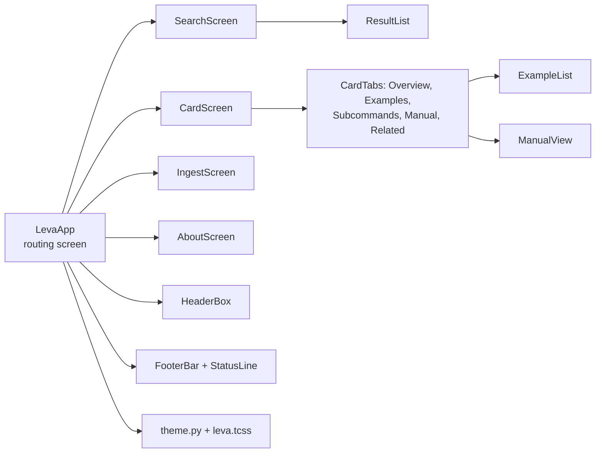
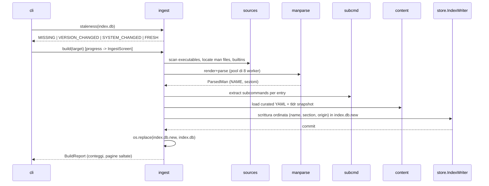

# ARCHITECTURE — Leva

- Progetto: Leva (`leva-sh`) · Data: 2026-11-20 · Versione: 0.1 · Stato: reviewed
- Doc collegati: [PRD](PRD.md) · [ANALYSIS](ANALYSIS.md) · [DESIGN-PATTERNS](DESIGN-PATTERNS.md) · [DESIGN-IN-THE-SMALL](DESIGN-IN-THE-SMALL.md) · [TEST-STRATEGY](TEST-STRATEGY.md) · [DESIGN-STATUS](DESIGN-STATUS.md) · ADR: [0001](ADR/ADR-0001-stack.md) [0002](ADR/ADR-0002-ingest-man-mandoc.md) [0003](ADR/ADR-0003-storage-sqlite-fts5.md) [0004](ADR/ADR-0004-curated-content-verifiable.md) [0005](ADR/ADR-0005-tui-textual-design-system.md) [0006](ADR/ADR-0006-distribuzione.md)

## 1. Vista C4

### 1.1 Context



Nessun accesso di rete a runtime. Il vendoring di tldr avviene solo a build/release (`tools/vendor_tldr.py`).

### 1.2 Container



### 1.3 Component (moduli e dipendenze)



Grafo aciclico (verificato a mano; in CI `import-linter` fa rispettare i contratti, vedi TEST-STRATEGY). `model`, `paths`, `placeholders`, `clipboard` sono foglie. `verify` non e' importato dal runtime.

## 2. Moduli

Ogni modulo: responsabilita' singola · interfaccia pubblica · dipendenze. Dettagli di firma in [DESIGN-IN-THE-SMALL](DESIGN-IN-THE-SMALL.md).

| Modulo | Responsabilita' singola | Interfaccia pubblica | Dipende da |
|---|---|---|---|
| `leva.model` | Definisce i tipi di dominio immutabili condivisi. | `Entry`, `Section`, `Example`, `Note`, `Subcommand`, `Origin`, `Kind`, errori `LevaError` e derivati | nessuno |
| `leva.paths` | Risolve le directory dati, cache, configurazione. | `LevaPaths.resolve(env)`, `.index_db`, `.config_file` | nessuno |
| `leva.placeholders` | Analizza i segnaposto `{{x}}` nei comandi di esempio. | `parse`, `to_plain`, `names`, `Segment` | nessuno |
| `leva.clipboard` | Copia testo negli appunti di sistema. | `Clipboard` (Protocol), `PbcopyClipboard`, `FakeClipboard` | nessuno |
| `leva.sources` | Legge dal sistema operativo la materia prima: eseguibili, builtin, man page, help in allowlist. | `ExecutableScanner`, `ManPageLocator`, `BuiltinSource`, `ProbeRunner`, `SystemInfo` | `model` |
| `leva.manparse` | Trasforma una man page in testo strutturato per sezioni. | `ManRenderer` (Protocol), `MandocRenderer`, `parse_man`, `ParsedMan` | `model` |
| `leva.subcmd` | Estrae i sottocomandi dal testo di una man page o di un help. | `SubcommandExtractor` (Protocol), `HyphenPageExtractor`, `SectionListExtractor`, `HelpTextExtractor` | `model` |
| `leva.content` | Legge il contenuto curato dal pacchetto, validandolo contro lo schema. | `ContentProvider` (Protocol), `CuratedYamlProvider`, `TldrSnapshotProvider`, `ContentRecord` | `model`, `placeholders` |
| `leva.store` | Gestisce lo schema SQLite versionato per le scritture dell'indice. | `IndexWriter`, `SCHEMA_VERSION`, `open_readonly` | `model` |
| `leva.repo` | Espone le letture dell'indice come query tipizzate. | `Repository` | `model` |
| `leva.search` | Classifica i risultati di una query. | `Searcher.search(query, limit)`, `SearchResult` | `repo` |
| `leva.library` | Offre alla UI un'API di lettura di alto livello. | `Library.open`, `Library.search`, `Card`, `Library.back/forward` (cronologia) | `repo`, `search` |
| `leva.ingest` | Orchestra la costruzione dell'indice dalle sorgenti. | `IndexBuilder.build`, `IndexBuilder.staleness`, `ProgressSink` (Protocol), `BuildReport` | `sources`, `manparse`, `subcmd`, `content`, `store`, `model` |
| `leva.tui` | Presenta la libreria in un'interfaccia Textual. | `LevaApp`, `StartTarget` | `library`, `clipboard`, `placeholders`, `ingest` |
| `leva.cli` | Compone le dipendenze e avvia l'app dalla riga di comando. | `main(argv) -> int` | tutti i moduli runtime |
| `leva.verify` | Verifica gli esempi curati in un ambiente isolato. | `Verifier`, `VerifyResult`, script `leva-verify` | `content`, `placeholders`, `repo` |

Componenti interni di `leva.tui` (non moduli separati, ognuno con un solo compito):



## 3. Data flow

### 3.1 Build dell'indice (primo avvio / rebuild)



### 3.2 Ricerca e apertura scheda

1. `SearchScreen` invia ogni cambio di input (debounce 30 ms) a `Library.search(q)`.
2. `Searcher`: fuzzy sui nomi/alias/intents in memoria + FTS5 su summary/corpo; fusione con pesi; ritorna `SearchResult` (nome, sezione, summary, score, motivo del match).
3. Invio su un risultato: `Library.open(name)` ritorna `Card` (summary, explain, note, esempi, sottocomandi, correlati, sezioni man); `CardScreen` la mostra, caricando `ManualView` lazy.
4. `leva <query>`: `cli` risolve `StartTarget`: match esatto (nome/alias) -> apre la scheda; altrimenti apre `SearchScreen` con la query precompilata.

### 3.3 Copia di un esempio

Click o `c` su un esempio -> `placeholders.to_plain(cmd)` -> `Clipboard.copy(text)` (`pbcopy`, stdin, timeout 2 s) -> `StatusLine` mostra `copied: <comando>` in verde per 3 s; in caso di errore, riga rossa breve (`clipboard unavailable`).

## 4. Confini e contratti tra moduli

- **UI/dominio**: `tui` non conosce SQL, subprocess o file system; parla solo con `Library`, `Clipboard`, `IndexBuilder` (tramite Protocol/oggetti iniettati da `cli`).
- **Sorgenti/ingest**: le sorgenti producono solo dataclass di `model`; `ingest` non conosce i dettagli di mandoc ma solo `ManRenderer`.
- **Ingest/store**: unico scrittore dell'indice e' `IndexWriter`; i lettori aprono il DB `mode=ro`.
- **Errori**: tutti derivano da `LevaError` con `message` (breve, mostrabile) e `hint` opzionale; i confini non fanno trapelare eccezioni di terze parti (`sqlite3`, `yaml`, `subprocess`).
- **Determinismo**: tutti gli input "ambientali" (env, directory, tempo, orologio) entrano come parametri (`SystemInfo`, `LevaPaths`, `clock`), mai letti implicitamente dai moduli di dominio.
- **Contratto di contenuto**: `schema: 1` nel YAML; un file con schema sconosciuto genera `ContentError` con `file:campo`.

## 5. Punti di estensione espliciti

| Punto | Come estendere | Moduli esistenti da modificare |
|---|---|---|
| Nuova sorgente di comandi (es. `--help` di tool Homebrew, pagine Linux) | implementare `ContentProvider` o una sorgente e registrarla nella lista in `cli` | nessuno (solo composition root) |
| Nuova strategia di sottocomandi | implementare `SubcommandExtractor` e aggiungerla alla lista in `cli` | nessuno |
| Nuovo renderer man (fallback, formati) | implementare `ManRenderer` | nessuno |
| Nuovo tipo di contenuto (v1.x ricette, v2 tutorial) | nuovo `kind` YAML + `ContentProvider` + migrazione tabella `content_item` + nuova `Tab` per la scheda o nuova `Screen` | `tui` (registrazione tab), `store` (nuova migrazione); `model` (nuovo tipo): documentato perche' il rendering e' per definizione UI |
| Nuove sezioni man (5, 7) o directory extra | config `sections`, `extra_man_paths`, `extra_bin_dirs` | nessuno |
| Nuova azione sugli esempi (es. "fill placeholders", invio al pane) | implementare `ExampleAction` registrata in `tui` | `tui` (registrazione) |
| Nuovo backend clipboard (Linux in futuro) | implementare `Clipboard` | nessuno |
| Nuovo tema | nuovo `Theme` in `tui.theme`; il design system resta vincolante | `tui` |

## 6. Struttura del repository (prevista)

```
leva-sh/
  pyproject.toml  uv.lock  .python-version
  src/leva/{model,paths,placeholders,clipboard,sources,manparse,subcmd,
            content,store,repo,search,library,ingest,verify,cli}.py|pkg
  src/leva/tui/{app.py,screens/,widgets/,theme.py,leva.tcss}
  src/leva/content/{commands/*.yaml, tldr/*.jsonl, tldr/SOURCE.json, ATTRIBUTION.md}
  src/leva/store/migrations/*.sql
  tools/{vendor_tldr.py, gen_formula.py}
  tests/{unit,integration,tui,live}/  tests/fixtures/{man,tldr,content}/
  docs/design/leva-sh/
```

## 7. Tracciabilita' requisiti -> moduli

| Requisito | Moduli |
|---|---|
| FR-1 | `ingest`, `sources`, `manparse`, `store`, `tui` |
| FR-2 | `sources`, `ingest` |
| FR-3 | `sources`, `manparse` |
| FR-4 | `library`, `repo`, `tui` |
| FR-5 | `manparse`, `repo`, `tui` |
| FR-6 | `content`, `store`, `library` |
| FR-7 | `content`, `store` |
| FR-8 | `subcmd`, `sources`, `content`, `repo`, `tui` |
| FR-9 | `search`, `repo`, `store` |
| FR-10 | `tui` |
| FR-11 | `tui` |
| FR-12 | `clipboard`, `placeholders`, `tui` |
| FR-13 | `cli`, `library`, `tui` |
| FR-14 | `placeholders`, `tui` |
| FR-15 | `library`, `tui` |
| FR-16 | `ingest`, `cli`, `tui` |
| FR-17 | `content`, `cli`, `tui` |
| FR-18 | `verify`, `content` |
| FR-19 | `tui` |
| FR-20 | `cli`, `sources`, `repo` |
| NFR-1 | `store`, `repo`, `tui` |
| NFR-2 | `search`, `repo` |
| NFR-3 | `ingest`, `manparse` |
| NFR-4 | `cli`, `ingest` (assenza di moduli di rete) |
| NFR-5 | `sources`, `clipboard`, `cli` |
| NFR-6 | `tui` |
| NFR-7 | tutti (vedi sez. 2: responsabilita' singole) |
| NFR-8 | `paths`, `ingest`, `store`, `verify` |
| NFR-9 | tutti (grafo aciclico, sez. 1.3) |
| NFR-10 | sez. 5 |
| NFR-11 | `sources`, `ingest`, `verify` |
| NFR-12 | `ingest`, `manparse` |
| NFR-13 | `tui` |
| NFR-14 | `content`, `ingest` |
| NFR-15 | `store` |
